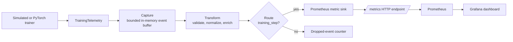

# Veyepr: Local AI Observability Pipeline

> **Portfolio case study:** an approachable, production-minded telemetry
> boundary for model training. It is intentionally runnable without cloud
> credentials, a GPU, PyTorch, or a proprietary routing product.

A complete, local demonstration of AI training observability:

1. A simulated or optional PyTorch training loop emits `loss`, `gradient_norm`,
   `batch_size`, `run_id`, and `step`.
2. A small, explicit Python implementation captures, normalizes, enriches, and
   routes those events, teaching the same flow-control concepts as Cribl Stream
   without a proprietary SDK or server.
3. The Prometheus route publishes current training values and route counts at
   `/metrics`.
4. Prometheus scrapes those metrics and Grafana loads a dashboard automatically.

The simulation is the default, so neither a GPU nor PyTorch is required.

## Public portfolio preview

The public, shareable experience is deployed through GitHub Pages:

**[Open the Veyepr portfolio preview](https://87Supreme-cell.github.io/Veyepr/)**

The Pages build is intentionally self-contained. It shows a browser-simulated
training signal so visitors can explore the console and Triolingo without
needing access to a running container, Prometheus, or Grafana. When the same
assets are served by the Python app, they automatically use the live local
`/metrics` and `/events` endpoints instead.

The workflow in [`.github/workflows/deploy-pages.yml`](.github/workflows/deploy-pages.yml)
publishes the static console whenever its frontend assets change on `main`. If
the preview is not yet available, enable **GitHub Pages → Build and deployment
→ GitHub Actions** in the repository settings, then rerun the workflow.

## Project path

This project is being built in deliberate passes so each milestone can be
explained and verified:

| Pass | Name | Intent |
|---|---|---|
| 1 | **Opening Salvo** | Publish an accessible portfolio preview, establish the narrative, and make the interface explorable without localhost. |
| 2 | **Harden and Verify** | Establish runtime checks, negative-path coverage, accessibility review, and reproducible verification. |
| 3 | **mock_deploy** | Model a production release path and deployment configuration without requiring cloud credentials. |
| 4 | **Break_b4_Buying** | Intentionally exercise failure modes, recovery paths, and operating assumptions before committing to infrastructure spend. |
| 5 | **Interlude** | Consolidate the working result into a concise, interview-ready narrative and evidence package. |

## Portfolio walkthrough

Veyepr is designed around one practical question: **how can an engineer tell
whether a model-training run is healthy without turning every training detail
into an expensive metric?**

The project demonstrates:

- **A stable telemetry contract.** `TrainingTelemetry` receives the training
  values at the application boundary and accepts both ordinary Python numbers
  and PyTorch-style scalar tensors.
- **A visible routing boundary.** Capture, normalization, enrichment, and
  routing are separate operations so the observable behavior is easy to
  explain, test, and replace with a managed router later.
- **Intentional metric cardinality.** `run_id` is the only training label;
  ever-changing values such as steps, timestamps, prompts, and inputs remain
  in the event stream rather than multiplying Prometheus time series.
- **An operational interface.** The root route is a live observation console
  powered by the same `/metrics` and `/events` APIs consumed by Prometheus.
  `/triolingo` is an interview-ready, plain-English walkthrough of the design.

### Interface routes

| Route | Audience | Purpose |
|---|---|---|
| `/` | Developer or operator | A live, auto-refreshing readout of loss, gradient norm, batch size, current step, routed count, and loss trend. |
| `/triolingo` | Interviewer or new CS student | Explains the project in plain English, system-thinking language, and code-thinking language. |
| `/events` | Developer | Shows a bounded sample of normalized events. |
| `/metrics` | Prometheus | Exposes the Prometheus text-format metric contract. |
| `/healthz` | Runtime platform | Provides a lightweight health response. |

## Architecture



`LocalStreamPipeline` in `src/ai_observability/router.py` is intentionally
small and inspectable. It represents the following local equivalents:

| Stream concept | Local demo equivalent | What it does |
|---|---|---|
| Source/capture | `EventCapture` | Retains a bounded, thread-safe sample of incoming records. |
| Pipeline transform | `LocalStreamPipeline._transform` | Validates fields, converts scalar tensor-like values with `.item()`, adds `captured_at` and `pipeline`. |
| Route | `LocalStreamPipeline.process` | Sends `training_step` events to the Prometheus sink and counts other types as dropped. |
| Destination | `PrometheusTrainingMetrics` | Exposes the latest per-run values and route counters. |

This is not a Cribl SDK wrapper and does not connect to a Cribl instance.

## Prerequisites

- Python 3.10 or later
- Docker Desktop with Docker Compose v2 for the full Prometheus/Grafana stack
- `curl` for the HTTP examples

PyTorch is optional. The `torch` backend downloads PyTorch separately and may
need a platform-specific install command from [pytorch.org](https://pytorch.org/).

## Quick start: complete local stack

Start the app, Prometheus, and Grafana:

```bash
docker compose up --build
```

When running Docker Compose locally, open:

| Local service | Address |
|---|---|
| Veyepr live console | `http://localhost:8000` |
| Triolingo explainer | `http://localhost:8000/triolingo` |
| App metrics | `http://localhost:8000/metrics` |
| Captured event sample | `http://localhost:8000/events` |
| Prometheus | `http://localhost:9090` |
| Grafana | `http://localhost:3000` (`admin` / `admin`) |

Grafana provisions **Local AI Observability / Local AI Training
Observability** automatically. Stop and remove containers plus persisted
metrics with:

```bash
docker compose down --volumes
```

## Quick start: Python app only

Create and activate a virtual environment, then install the project:

```bash
python3 -m venv .venv
source .venv/bin/activate
python -m pip install --upgrade pip
python -m pip install -e ".[dev]"
ai-observability-demo --run-id notebook-demo --interval-seconds 1
```

The default `simulated` backend continuously emits plausible decreasing loss
and gradient-norm values. It exposes:

| Endpoint | Purpose |
|---|---|
| `GET /healthz` | Liveness response: `{"status":"ok"}` |
| `GET /metrics` | Prometheus text exposition |
| `GET /events` | Last captured normalized events, useful for learning and debugging |
| `GET /` | Veyepr's live observation console |
| `GET /triolingo` | The plain-English interview explainer |

Use the optional real PyTorch loop only after installing a compatible PyTorch
distribution:

```bash
python -m pip install -e ".[torch]"
ai-observability-demo --backend torch --run-id torch-demo --batch-size 32
```

If PyTorch is unavailable, the default simulation continues to work.

## Inspecting the telemetry

With the app running:

```bash
curl -s http://localhost:8000/healthz
curl -s http://localhost:8000/events
curl -s http://localhost:8000/metrics | grep '^ai_'
```

An event in `/events` includes the source values and local transform metadata:

```json
{
  "event_type": "training_step",
  "run_id": "notebook-demo",
  "step": 5,
  "loss": 1.65,
  "gradient_norm": 2.19,
  "batch_size": 32,
  "timestamp": "2026-01-01T00:00:00+00:00",
  "captured_at": "2026-01-01T00:00:00+00:00",
  "pipeline": "local-cribl-equivalent"
}
```

The precise simulated values and timestamps vary.

### Prometheus queries

Run these in the Prometheus expression browser or Grafana Explore:

```promql
# Latest loss for each run
ai_training_loss

# Current gradient norm
ai_training_gradient_norm

# Current step
ai_training_current_step

# Ingestion rate over one minute
rate(ai_telemetry_events_total{route="prometheus"}[1m])

# Events that did not match the training route
ai_telemetry_events_total{route="dropped"}
```

`run_id` is the only training label. Do **not** make `step`, timestamps, model
inputs, prompts, or request IDs Prometheus labels in a real system: they create
unbounded cardinality. Put high-cardinality detail in logs or a telemetry/event
store instead.

## Metrics contract

| Metric | Type | Labels | Meaning |
|---|---|---|---|
| `ai_training_loss` | Gauge | `run_id` | Latest observed loss. |
| `ai_training_gradient_norm` | Gauge | `run_id` | Latest observed gradient L2 norm. |
| `ai_training_batch_size` | Gauge | `run_id` | Latest batch size. |
| `ai_training_current_step` | Gauge | `run_id` | Latest completed step. |
| `ai_telemetry_events_total` | Counter | `route` | Records accepted by the Prometheus route or dropped by routing. |

## Replacing the local router with Cribl Stream

The local router is a conceptual stand-in only. In a real deployment:

1. Emit structured JSON logs/events from the training workload with the same
   five core fields plus a stable event type such as `training_step`.
2. Configure a Cribl Stream Source appropriate to the transport: HTTP, Kafka,
   OpenTelemetry, Fluent Forward, or an agent/file source. Secure the
   transport with TLS and authentication.
3. Create a Pipeline that validates numeric fields, normalizes the timestamp,
   adds environment/model/version metadata, redacts sensitive data, and
   samples or aggregates high-volume step events.
4. Add Routes that send valid training telemetry to the chosen destination:
   Prometheus remote write-compatible metrics infrastructure, an OpenTelemetry
   collector, a log/event store, and optionally a dead-letter destination for
   invalid events.
5. Apply production safeguards in Stream: route filtering, persistent queues,
   backpressure limits, monitoring/alerts, least-privilege credentials, and
   retention controls. Use Cribl's deployed product documentation for the
   exact source, pipeline, route, and destination configuration syntax.
6. Preserve the metric contract above, especially the bounded labels, so the
   Grafana panels and PromQL remain stable after the replacement.

This repository deliberately leaves vendor-specific configuration out so it is
runnable locally with no account, token, or cloud resource.

## Tests

Run the focused conversion, route, and metric-exposition tests:

```bash
python -m pytest
```
