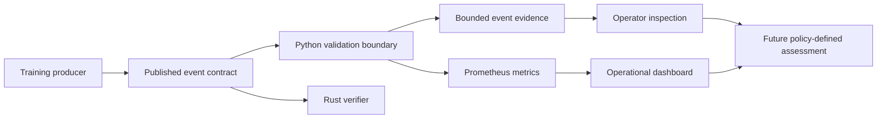

# Veyepr: Evidence-First AI Usage Assurance

Veyepr is a local reference implementation for **collecting, validating, and
observing AI-training telemetry**. It is being developed from a product-lead
perspective: before an enterprise is handed a score about AI usage or model
output, it should be able to inspect the evidence, the contract, and the
decision policy behind that score.

**Public preview:** [Veyepr evidence console](https://87supreme-cell.github.io/Veyepr/)<br>
**Decision record:** [Pass 2 product and architecture decisions](https://87supreme-cell.github.io/Veyepr/decision-record.html)
**Developer mode:** [Local verification paths](https://87supreme-cell.github.io/Veyepr/developer-mode.html)

## What this project does today

1. Produces a structured training event with a run ID, step, loss, gradient
   norm, batch size, and timestamp.
2. Rejects malformed training events against a published contract.
3. Exposes accepted telemetry as bounded Prometheus metrics and preserves a
   small event-inspection window.
4. Proves the contract through two implementations: the Python reference
   pipeline and an independent Rust verifier.
5. Provides a dependency-free browser preview and explicit local verification
   commands.

## What this project does **not** claim to do

Veyepr does **not** currently score whether a model answer is factually
correct, safe, compliant, or appropriate for a specific business use. Those
are consequential judgments. A credible implementation needs a declared
rubric, permitted data sources, a human review owner, retained evidence, and
an appeals or correction process.

It also does **not** send prompts to an LLM, perform deep research, operate a
coding agent, or run one-shot prompt evaluations. The tests in this repository
are deterministic telemetry, contract, HTTP, and deployment checks. They use
fixture JSON and simulated numeric training signals only.

## Pass 2 — Harden and Verify: decision record

This pass responds to explicit product review observations. The table is kept
in the README so a reviewer can see the decisions without reverse-engineering
the code.

| Observation | Product decision | Evidence in this repository | Deliberate boundary |
| --- | --- | --- | --- |
| The public site felt like a gimmick or sales page. | Reframe the interface as an evidence console and decision record. Remove the mascot-led hero and all interview-coaching language. | [`index.html`](src/ai_observability/static/index.html), [`decision-record.html`](src/ai_observability/static/decision-record.html) | The public preview is still a simulated view; it labels itself as such. |
| Data could not be independently validated. | Publish a strict event schema, fixtures, and dual-runtime validation. | [`training-event.schema.json`](contracts/training-event.schema.json), [`validation.py`](src/ai_observability/validation.py), [`verifier/`](verifier/) | Validation proves event shape and basic semantic constraints, not model-output quality. |
| Python dependencies could drift or fail. | Pin the reference runtime dependency and provide a separately compiled Rust verifier with a committed lockfile. | [`pyproject.toml`](pyproject.toml), [`verifier/Cargo.toml`](verifier/Cargo.toml), [`verifier/Cargo.lock`](verifier/Cargo.lock) | Python remains the transparent reference service; Rust is the independent contract checker, not an unreviewed full rewrite. |
| The tests and their inputs were unclear. | Document every test class, fixture, runner, and non-use of prompts below. | [Test catalogue](#test-catalogue-and-inputs) | No LLM evaluation is implied by these tests. |
| Advanced controls should require demonstrated understanding. | Add a short, button-led developer-mode knowledge check before exposing local inspection instructions. | [`developer-mode.html`](src/ai_observability/static/developer-mode.html) | This is an intent/learning check, **not** access control. Real privileged actions require server-side authorization. |
| Docker should not be required. | Make the browser preview and contract-fixture verification run locally without Docker or external Python packages. Keep Compose as an optional integration proof. | [`run-local-preview.sh`](scripts/run-local-preview.sh), [`verify-local.sh`](scripts/verify-local.sh) | The full Prometheus/Grafana integration remains optional because it is a separate infrastructure test. |

## Architecture and assurance boundary



The shared contract is
[`contracts/training-event.schema.json`](contracts/training-event.schema.json).
It requires exactly these fields:

| Field | Constraint | Why it exists |
| --- | --- | --- |
| `event_type` | Must be `training_step` | Makes route intent explicit. |
| `run_id` | Non-empty, maximum 128 characters | Associates events without accepting unbounded identifiers. |
| `step` | Non-negative integer | Represents training progress. |
| `loss` | Finite number | Captures reported training error. |
| `gradient_norm` | Finite, non-negative number | Captures reported update magnitude. |
| `batch_size` | Positive integer | Provides training-volume context. |
| `timestamp` | RFC 3339 with a timezone | Establishes an unambiguous event time. |

The schema rejects unknown fields. That is intentional for the reference
contract: an enterprise integration should version a changed contract instead
of silently accepting fields with unreviewed meaning.

## Run locally with no Docker

### 1. Open the public preview from local files

This requires only a standard Python 3 installation; it uses
`python3 -m http.server` and has **no pip dependencies**:

```bash
./scripts/run-local-preview.sh
```

Open `http://127.0.0.1:8000`. The local preview contains browser-simulated
telemetry and is suitable for reviewing the interface, decisions, and
developer-mode flow. It does not claim to be a running telemetry backend.

### 2. Verify the local preview and contract fixtures

```bash
make verify-local
```

This starts a temporary local static server, checks all three public pages,
checks the preview metrics fixture, and parses the JSON Schema plus valid
fixture. It needs only `python3`, `curl`, and standard shell tools.

### 3. Verify the contract with Rust, without Docker

Install Rust 1.79 or newer locally, then run:

```bash
cd verifier
cargo test --locked
cargo run --locked -- ../fixtures/valid-training-event.json
```

`Cargo.lock` pins the exact dependency graph. The verifier emits a JSON result
and exits nonzero for invalid input:

```bash
cargo run --locked -- ../fixtures/invalid-training-event.json
# {"valid":false,"error":"..."}
```

## Optional Python reference service

The service is optional for the public preview. It is useful when validating
the live capture/route/Prometheus behavior:

```bash
python3 -m venv .venv
source .venv/bin/activate
python -m pip install --upgrade pip
python -m pip install -e ".[dev]"
ai-observability-demo --run-id local-reference --interval-seconds 1
```

The runtime uses a pinned `prometheus-client` version. It exposes:

| Endpoint | Evidence provided |
| --- | --- |
| `GET /healthz` | Process liveness |
| `GET /events` | Last normalized, accepted events |
| `GET /metrics` | Prometheus metrics and accepted/rejected validation counters |
| `GET /` | Evidence console backed by the local endpoints |
| `GET /decision-record` | Product and architecture choices |
| `GET /developer-mode` | Local developer instructions after the knowledge check |

## Test catalogue and inputs

The tests are intentionally small, deterministic, and explicit about their
inputs. They do not use prompts, model completions, deep-research systems, or
coding agents.

| Test area | Runner | Input | What it proves |
| --- | --- | --- | --- |
| Tensor-like conversion | `tests/test_models.py` | A test object exposing `.item()` | Python can normalize scalar values without importing PyTorch. |
| Semantic field checks | `tests/test_models.py` | Invalid batch sizes | Invalid numerical constraints are rejected. |
| Capture, route, and exposition | `tests/test_router.py` | A constructed valid telemetry event and an unknown event | Accepted records route to Prometheus; unmatched records are counted as dropped. |
| Contract acceptance | `tests/test_validation.py` | [`valid-training-event.json`](fixtures/valid-training-event.json) | The Python validator accepts the published happy-path example. |
| Contract rejection | `tests/test_validation.py` | [`invalid-training-event.json`](fixtures/invalid-training-event.json) | Empty IDs, negative steps, zero batch size, and invalid timestamps fail. |
| Validation telemetry | `tests/test_validation.py` | One valid and one invalid fixture | Accepted and rejected contract counters are exposed. |
| HTTP delivery | `tests/test_app.py` | Local ephemeral HTTP server | The evidence console, decision record, and developer mode are served. |
| Rust contract verification | `verifier/src/main.rs` | Constructed valid event, empty ID, unknown JSON field | The independent verifier enforces the same key boundary. |
| Local preview proof | `scripts/verify-local.sh` | Static files and fixtures | The no-Docker preview and contract inputs are available locally. |
| Optional stack proof | `scripts/verify-compose.sh` | Docker Compose services | The app, metrics, events, and Prometheus scrape target become healthy together. |

Run the Python suite:

```bash
python3 -m pytest
```

## Developer mode is not authorization

The developer-mode page asks three multiple-choice questions:

1. Why changing step values do not belong in Prometheus labels.
2. What the current verifier proves.
3. Where consequential output grading must live.

Passing stores a flag only in the browser's `sessionStorage` and reveals
documentation links. It is deliberately **not** a safety, identity, or access
control mechanism. The public project has no harmful or privileged tools.
Production developer access must be enforced by an authenticated server,
role-based policy, audit logging, and approvals—not a client-side quiz.

## Pass 3 — mock deployment and review-only sentinel

Pass 3 models a narrow, local response to policy-relevant AI-agent behavior:
it records a sanitized tool action, evaluates the action against a declared
policy, and creates a review package when a rule matches. It does **not** make
an automatic enforcement decision.

### Selected product decisions

| Decision | Selected approach | Reason |
|---|---|---|
| Initial signal source | Agent and AI tool-call metadata, including declared OAuth scope use and export intent | The first problem is behavioral visibility around tool use, not a shallow prompt filter. |
| Response | Record and route for human review only | A matched rule can be ambiguous. No person should be automatically blocked or punished from this prototype's output. |
| Package retention | Metadata and content hashes only | A reviewer can verify that the same prompt/output was referenced without placing raw sensitive content in the local package. |
| Review fairness | The package names both `security_reviewer` and `session_subject` as review parties | Evidence should support a subject's explanation, not create an unchallengeable accusation. |

### What the sentinel evaluates

The local contract in
[`contracts/agent-action.schema.json`](contracts/agent-action.schema.json)
accepts only a sanitized action record:

- Pseudonymous actor and session references.
- Tool name, action type, opaque resource reference, classification, target
  destination class, and estimated data volume.
- Declared requested scopes.
- SHA-256 hashes of prompt and tool output.

It rejects raw prompts, raw outputs, unknown fields, and malformed metadata.
The included policy is intentionally small and transparent:

1. Requesting an OAuth scope outside the local allowlist requires review.
2. Exporting sensitive data to an unknown destination or above the local
   threshold requires review.
3. Mutating a sensitive asset requires review when that policy switch is on.

The result is only `no_review_required` or `review_required`, and its response
mode is always `review_only`. A review-required result is not proof of
malicious intent, misconduct, or a policy violation.

### What the review package contains

`./scripts/mock-deploy-preflight.sh` writes two new JSON files:

| Artifact | Contents |
|---|---|
| `preflight-report.json` | Deployment inputs, SHA-256 file checks, runtime details, passed checks, declared limitations, and the review outcome. |
| `review-package.json` | Sanitized action metadata, prompt/output hashes, policy ID and version, findings, review parties, and a tamper-evident SHA-256 payload digest. |

The package is **not immutable by itself**. Its digest only reveals later
changes if the original digest is stored independently. A real system would
need signed packages, immutable retention, identity-based access control,
case-management workflow, and a documented subject-access process.

### Run the mock deployment locally

No Docker, network service, token, or cloud account is required:

```bash
./scripts/mock-deploy-preflight.sh artifacts/review-demo
```

The script refuses to overwrite an existing evidence directory. The supplied
fixture describes a sensitive export to an unknown external destination with
an unapproved OAuth scope. Its expected result is `review_required` with two
findings; it does not block or report anything.

To run the same command with the default output path:

```bash
make mock-deploy
```

## Sentinel non-goals and security boundary

This repository is **not** a transparent network proxy, endpoint sensor, OAuth
collector, SharePoint monitor, screen-capture agent, or active enforcement
product. It does not retrieve JWTs, intercept traffic, extract data, suspend
sessions, send alerts to a security team, or evaluate real employee behavior.

Those capabilities would require explicit legal, privacy, security, identity,
retention, and employee-notice decisions. If they are considered later, the
out-of-band enforcement component must be independently authorized and unable
to be controlled by the LLM it observes. Its records must be reviewable by
both security and the affected subject; no client-side UI gate can provide
that guarantee.

## Optional Compose integration proof

Docker is not required for normal local use. If Docker Desktop is available,
the following adds Prometheus and Grafana to the reference service:

```bash
make verify-compose
```

This command builds the services, waits for `/healthz`, asserts the training
and validation metrics, checks captured events, and confirms that Prometheus
reports the telemetry target as healthy. It shuts the stack down afterward.

## Metric contract

| Metric | Type | Labels | Meaning |
| --- | --- | --- | --- |
| `ai_training_loss` | Gauge | `run_id` | Latest reported loss from an accepted event. |
| `ai_training_gradient_norm` | Gauge | `run_id` | Latest reported gradient norm from an accepted event. |
| `ai_training_batch_size` | Gauge | `run_id` | Latest reported batch size from an accepted event. |
| `ai_training_current_step` | Gauge | `run_id` | Latest reported completed step. |
| `ai_telemetry_events_total` | Counter | `route` | Records routed to Prometheus or dropped. |
| `ai_telemetry_validation_events_total` | Counter | `outcome` | Records accepted or rejected by the contract validator. |

`step`, timestamps, prompts, model inputs, request IDs, and model outputs are
not metric labels. They have unbounded cardinality and should be handled by an
appropriate event store subject to the organisation's data policy.

## Roadmap

| Pass | Name | Focus |
| --- | --- | --- |
| 1 | Opening Salvo | Public evidence console and accessible project narrative. |
| 2 | Harden and Verify | Contract validation, independent verifier, documented tests, local proof, and scope boundaries. |
| 3 | mock_deploy | A review-only local deployment model for sanitized agent-action policy evidence. |
| 4 | Break_b4_Buying | Deliberately test failure modes and recovery assumptions before infrastructure spend. |
| 5 | Interlude | Consolidate verified evidence, decisions, and next-step recommendations. |
