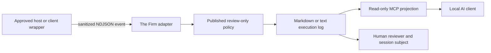

# The Firm: Host-Controlled Local AI Evidence Layer

## What this branch adds

The Firm is the first local-LLM/agent attachment layer for Veyepr. It accepts
**sanitized, host-observed tool-action metadata** and writes a review-only
execution log that a person can export as Markdown or plain text.

It does not intercept network traffic, collect raw prompts, collect raw tool
outputs, read OAuth/JWT tokens, or make an access-control decision.



## The authority boundary

The critical design decision is that the **model is not the authority**.

| Component | Can do | Cannot do |
| --- | --- | --- |
| Approved host / client wrapper | Observe a declared tool action and emit the sanitized event. Configure the adapter’s policy and export directory. | Treat a review signal as an automatic personnel decision. |
| The Firm adapter | Validate the published event contract, apply the review-only policy, chain entry digests, and write a new Markdown or text export. | Grant permission, block actions, retrieve raw content, overwrite prior exports, or choose policy on behalf of a model. |
| Local AI model | Read summaries through the MCP server and explain the evidence to a user. | Create authoritative events, write/erase logs, choose export paths, modify policy, grant access, or decide discipline. |
| Human reviewer and session subject | Review the same evidence and add context through a future governed process. | Infer intent solely from a `review_required` result. |

This makes the model a **consumer of evidence**, not the controller of the
observer. A model can be wrong, manipulated, or unavailable without changing
what the host adapter recorded.

### Protocol boundary versus operating-system boundary

This implementation proves the **protocol boundary**: the MCP server offers no
write, approval, policy-change, or path-selection tool. That alone does not
protect a log if an AI client is separately given a generic shell, broad file
access, or permission to launch the adapter with arbitrary arguments.

For a real local deployment, run the adapter under a dedicated host-owned
account or service boundary; grant the AI client only the read-only MCP
connection; and restrict policy and export directories with operating-system
permissions. The model must not hold a terminal capability that can modify the
same files.

## Layer 1: the implemented adapter

The host provides one JSON object per line in an NDJSON file or stream. Each
object must pass the existing `agent-action` contract:

- opaque session, action, actor, and target references;
- tool name and action type;
- classification, destination class, declared scopes, and estimated bytes;
- SHA-256 hashes of prompt and tool output.

Unknown fields and raw content are rejected. The adapter then:

1. Parses the event with `AgentAction.from_record`.
2. Evaluates it with the host-owned, `review_only` policy.
3. Adds its own `host_observed` source marker; callers cannot set this field.
4. Links the event to the preceding entry with a SHA-256 digest chain.
5. Writes either `firm-execution-log.md` or `firm-execution-log.txt`.
6. Refuses to overwrite a previously written export.

Run the safe local fixture demonstration:

```bash
./scripts/run-firm-adapter.sh artifacts/firm-demo markdown
cat artifacts/firm-demo/firm-execution-log.md

# Or write a plain-text export to a new directory.
./scripts/run-firm-adapter.sh artifacts/firm-demo-text text
cat artifacts/firm-demo-text/firm-execution-log.txt
```

The bundled fixture contains one normal internal read and one sensitive export
that requires human review. It contains hashes, not real prompt or output
content.

## Layer 1 MCP projection

The local MCP server is intentionally **read-only**. Its two tools are:

| Tool | Returns | Why it is safe |
| --- | --- | --- |
| `veyepr_execution_log_summary` | Log filename, byte count, SHA-256 digest, entry count, and review-required count. | It accepts no arguments, so a model cannot choose a path or read arbitrary files. |
| `veyepr_policy_boundary` | Policy ID/version, review-only and metadata-only modes, and the explicit model restrictions. | It exposes the boundary but cannot modify it. |

The model never receives a `record`, `approve`, `allow`, `block`, `delete`, or
`configure` tool. Host command-line arguments provide the log and policy
paths before the MCP server starts.

[`examples/the-firm.mcp.json`](examples/the-firm.mcp.json) shows a local
stdio MCP configuration after the adapter has produced an export. It is an
example configuration, not a credential-bearing file.

## Layer 2: intentionally deferred

The next layer should be a governed **case handoff and subject-access service**:

1. A human reviewer opens the evidence package.
2. The session subject can view the same sanitized record and provide context.
3. Policy versions, retention, access, signature, and correction decisions
   are controlled by named owners.
4. An external system may receive a signed case reference only after those
   governance controls exist.

Layer 2 is not built in this branch. It must not be replaced with automatic
blocking, an LLM-generated verdict, or a client-side quiz.

## Interview explanation

**Why use an adapter instead of a skill?** A skill is guidance that an LLM may
or may not follow. The adapter is a separate host process that validates the
event contract before recording it.

**Why provide MCP at all?** MCP gives a local AI client a consistent,
inspectable way to summarize evidence. It is deliberately read-only so the
model cannot confuse “I saw a review signal” with “I have permission to act.”

**Why export Markdown or text?** The files are portable, reviewable in a pull
request or incident handoff, and do not require a cloud database for the first
local trial. The digest chain makes edits detectable when a digest is retained
independently; it is not immutable storage or a digital signature.

**What would make this production-ready?** Authenticated host integration,
signed/immutable retention, role-based and subject-access controls, data
retention policy, approved connectors, case-management ownership, and a
privacy/legal review.
